# Assignment 2 — Question 3 Architecture and Workflow

```mermaid
flowchart LR
    A["Jira / Agile planning<br/>AGILE_ASSIGNMENT_Q1.md<br/>JIRA_BACKLOG.md"]
    B["Git source control<br/>GitHub: Overpowered21/quickbite<br/>main branch"]
    C["GitHub Actions<br/>.github/workflows/ci-cd.yml<br/>Node 20 + npm test"]
    D["QuickBite application deployment<br/>Dockerfile + docker-compose.yml<br/>http://localhost:3000"]
    E["Q2 model and monitoring deployment<br/>q2/compose.yaml<br/>same repository checkout"]
    F["MLflow lifecycle<br/>train → track → register/version<br/>champion alias"]
    G["Model API<br/>q2/service.py<br/>/health, /predict, /metrics"]
    H["Prometheus<br/>5-second scrape of model-service"]
    I["Grafana<br/>provisioned Q2 dashboard"]
    J["Evidence and feedback<br/>deployment status, model version,<br/>availability, traffic, errors, p95 latency"]

    A -->|prioritized stories and acceptance criteria| B
    B -->|push, pull request, or manual dispatch| C
    C -->|automated build, test, deploy, verify, cleanup| D
    B -.->|Q2 demonstration command:<br/>docker compose -f q2/compose.yaml up --build -d| E
    E -->|MLflow healthy, then training| F
    F -->|registered champion loaded at startup| G
    G -->|Prometheus /metrics endpoint| H
    H -->|Prometheus datasource| I
    D -->|application deployment result| J
    I -->|monitoring result| J
    J -.->|issues and improvements become backlog work| A

    classDef planning fill:#e8f1ff,stroke:#356ae6,color:#102a56;
    classDef delivery fill:#eaf8ee,stroke:#2e8b57,color:#123b24;
    classDef ml fill:#fff3df,stroke:#d9822b,color:#5a2b08;
    classDef monitor fill:#f4eaff,stroke:#8646b8,color:#34144d;

    class A planning;
    class B,C,D delivery;
    class E,F,G ml;
    class H,I,J monitor;
```

**Diagram key:** Solid arrows are the implemented flow. The dashed arrow identifies the
existing Q2 Compose demonstration path from the same Git checkout; the current
`.github/workflows/ci-cd.yml` directly automates the root QuickBite Compose deployment,
while Q2 is started with the documented `q2/compose.yaml` command.
